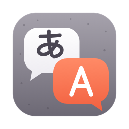
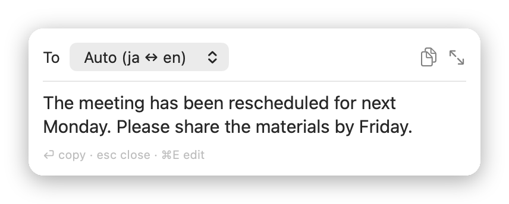
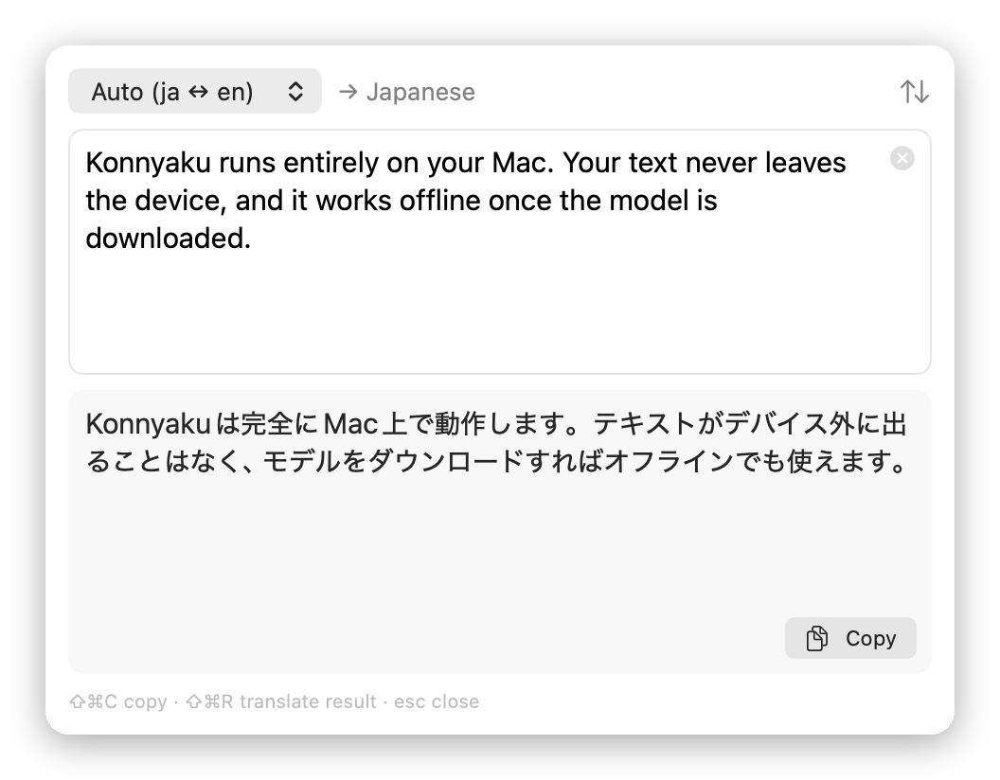
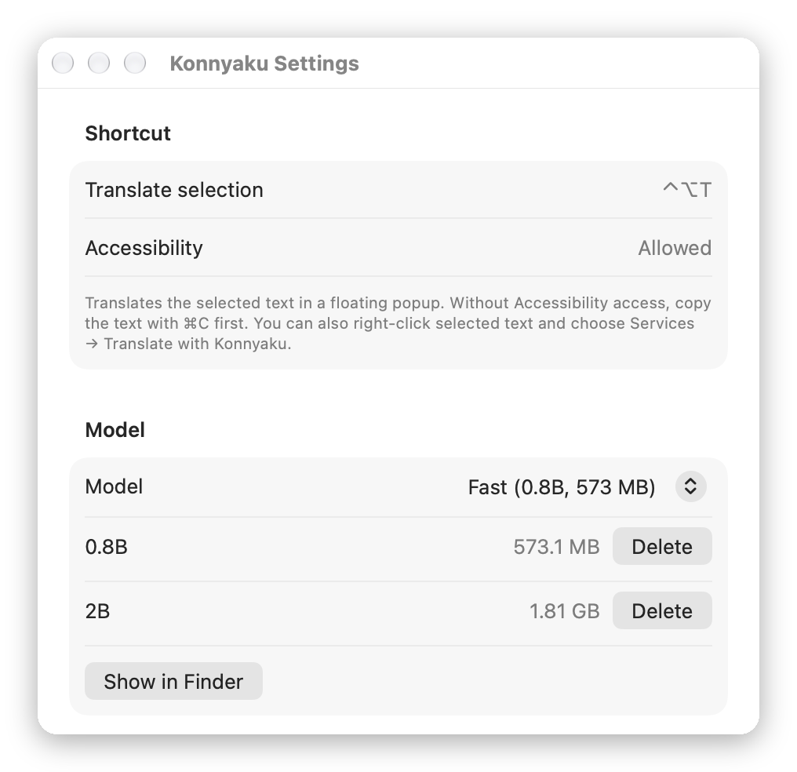

<div align="center">

[English](README.md) | **日本語**



<h1>Konnyaku</h1>

<p>
  <strong>Mac のメニューバーで動く、速くてプライベートなオンデバイス翻訳。</strong><br>
  テキストを選んで <kbd>⌃</kbd><kbd>⌥</kbd><kbd>T</kbd> を押すだけ。<br>
  PLaMo 3 Translate で動きます。翻訳はすべて Mac の中で行われます。
</p>

[](https://github.com/yukinoda/konnyaku/releases/latest)
[](LICENSE)


[ダウンロード](../../releases/latest) ·
[使い方](#usage) ·
[よくある質問](#faq) ·
[CLI](#cli) ·
[ソースからビルド](#build-from-source)

<picture>
  <source media="(prefers-color-scheme: dark)" srcset="assets/screenshots/popup-dark.png">
  
</picture>

</div>

> [!NOTE]
> Konnyaku は公開されたばかりのアプリです。Apple の公証を受けていないため、初回起動時にひと手間かかります。[インストール](#install)を参照してください。

## 特長 <a id="features"></a>

- **オンデバイス。** Preferred Networks の [PLaMo 3 Translate](https://www.preferred.jp/ja/blog/tech/plamo-3-translate-weight-release) を、内蔵の llama.cpp で動かします。アカウントも API キーも不要で、ネットワークを使うのはモデルのダウンロードのときだけです。
- **どのアプリでも。** テキストを選んで ⌃⌥T を押すか、サービスメニューから。
- **標準は日本語 ⇄ 英語。** 中国語、韓国語、フランス語、ドイツ語、スペイン語にも翻訳できます。
- **ポップアップとエディタ。** ポインタの横に小さなポップアップを表示。⌘E で、入力しながら翻訳するエディタを開けます。
- **2 つのモデルサイズ。** 速い 0.8B（573 MB、既定）と高品質な 2B（1.8 GB）。選んだモデルだけを初回使用時にダウンロードし、固定した SHA-256 で検証します。
- **ネイティブ。** SwiftUI 製のメニューバーアプリで、実行時に Python や Homebrew は不要です。

## インストール <a id="install"></a>

[Releases](../../releases) から `Konnyaku-<version>.dmg` をダウンロードして開き、Konnyaku を「アプリケーション」へドラッグします。Apple シリコン搭載の Mac と macOS 14 以降が必要です。

Konnyaku は Apple Developer ID で署名しておらず、公証も受けていません（有料の Apple Developer アカウントが必要なため）。そのため macOS は初回起動をブロックします。macOS 15（Sequoia）以降では、以前の「右クリック → 開く」は使えません。代わりに次の手順で開きます。

1. Konnyaku を一度開き、警告を閉じます。
2. システム設定 →「プライバシーとセキュリティ」を開いて下までスクロールし、Konnyaku の横の **「このまま開く」** をクリックします。

ターミナルで隔離属性を外す方法もあります。

```bash
xattr -dr com.apple.quarantine /Applications/Konnyaku.app
```

ダウンロードを検証するには、公開されている `.sha256` ファイルを DMG と同じ場所に置いて `shasum -a 256 -c Konnyaku-<version>.dmg.sha256` を実行します。

## 使い方 <a id="usage"></a>

**ポップアップ。** 任意のアプリでテキストを選び、⌃⌥T を押します。ポインタの横に小さなポップアップで翻訳が表示されます。もう一度 ⌃⌥T を押すと隠れます。

**サービス。** テキストを選び、右クリック →「サービス」→「Translate with Konnyaku」。翻訳済みの状態で翻訳ウインドウが開きます。ショートカットを割り当てるには、システム設定 →「キーボード」→「キーボードショートカット」→「サービス」→「テキスト」→「Translate with Konnyaku」を設定します。

**メニューバー。** 「Translate Clipboard (⌃⌥T)」「Open Translator…」「Settings…」「About Konnyaku」（アプリの表示は英語です）。メニューの項目が翻訳するのはクリップボードだけです。⌃⌥T のホットキーは、まず選択範囲を読み取ります。

| 場所 | キー | 動作 |
| --- | --- | --- |
| どこでも | <kbd>⌃</kbd><kbd>⌥</kbd><kbd>T</kbd> | 選択範囲を翻訳、または Konnyaku のウインドウを隠す |
| ポップアップ | <kbd>Return</kbd> | 翻訳をコピーして閉じる |
| ポップアップ | <kbd>⌘</kbd><kbd>E</kbd> | エディタを開く |
| ポップアップ、エディタ | <kbd>Esc</kbd> | 閉じる（ポップアップは外をクリックしても閉じる） |
| エディタ | <kbd>⇧</kbd><kbd>⌘</kbd><kbd>C</kbd> | 翻訳をコピー |
| エディタ | <kbd>⇧</kbd><kbd>⌘</kbd><kbd>R</kbd> | 翻訳結果を Auto（ja ↔ en）でもう一度翻訳 |

<p align="center">
  <picture>
    <source media="(prefers-color-scheme: dark)" srcset="assets/screenshots/editor-dark.png">
    
  </picture>
</p>

**設定** では、ショートカットとアクセシビリティの状態を確認でき、モデルの選択と削除ができます。選んだモデルは、そのモデルで初めて翻訳するときにダウンロードされます。

- モデルは初回使用時に、固定した Hugging Face のリビジョンから `~/Library/Application Support/Konnyaku/` にダウンロードされます。標準は 0.8B です。
- メモリ使用量は、モデルが読み込まれている間は 0.8B が約 0.8 GB、2B が約 2.1 GB です。モデルは最初の翻訳で読み込まれ、5 分間使わないと解放されます。
- モデルが読み込み済みなら、1 文の翻訳は 1 秒もかかりません。

<p align="center">
  <picture>
    <source media="(prefers-color-scheme: dark)" srcset="assets/screenshots/settings-dark.png">
    
  </picture>
</p>

## プライバシーとアクセシビリティ <a id="privacy-and-accessibility"></a>

翻訳はすべて Mac の中で行われます。アプリがネットワークを使うのは、Hugging Face（huggingface.co とそのダウンロード用 CDN）からのモデルのダウンロードだけです。

選択中のテキストを読み取るには、アクセシビリティの許可が必要です。初回に Konnyaku が許可を求めます。設定からも許可でき、システム設定 →「プライバシーとセキュリティ」→「アクセシビリティ」へのリンクがあります。

Konnyaku はアクセシビリティ経由で選択範囲を読み取ります。対応していないアプリ（多くのブラウザ）では ⌘C を送り、あとでクリップボードを元に戻します。その間は選択範囲がクリップボードに入るため、クリップボードマネージャやユニバーサルクリップボードに記録されることがあります。コピーに 0.5 秒ほど以上かかった場合、選択範囲はクリップボードに残ります。メールの添付ファイルのような「ファイルプロミス」は、ファイル本体なしで戻ります。許可がない場合は、先に ⌘C でコピーすれば ⌃⌥T でクリップボードを翻訳します。

## よくある質問 <a id="faq"></a>

<details>
<summary><strong>⌃⌥T を押しても何も起きない</strong></summary>

⌃⌥T のホットキーは固定です。何も起きない場合は、別のアプリがすでに同じショートカットを使っている可能性があります。代わりにサービスメニューを使ってください。

</details>

<details>
<summary><strong>⌃⌥T で選択範囲ではなくクリップボードが翻訳される（VS Code、Slack）</strong></summary>

一部の Electron アプリは、テキストを選択していてもアクセシビリティに空の選択範囲を返します。その場合 ⌃⌥T はクリップボードを翻訳するので、先にコピーするか、サービスメニューを使ってください。

</details>

<details>
<summary><strong>アップデート後にアクセシビリティの許可をまた求められる</strong></summary>

Konnyaku はアドホック署名のため、macOS は新しいバージョンを別のアプリとして扱います。アップデート後は、アクセシビリティの一覧から Konnyaku を削除してもう一度許可してください。アップデートのたびに Konnyaku が改めて許可を求めます。

</details>

<details>
<summary><strong>Homebrew でインストールできる？</strong></summary>

まだできません。[Releases](../../releases) から DMG をダウンロードしてください。

</details>


## CLI

スクリプトやターミナル向けの Python 版コマンドラインツールです。Apple シリコン搭載の Mac と [uv](https://docs.astral.sh/uv/) が必要です。

```bash
./konnyaku.py "会議は来週の月曜日に変更されました。"
# The meeting has been rescheduled for next Monday.

echo "This system is convenient." | ./konnyaku.py -f plain
# このシステムは便利だ。

./konnyaku.py -t fr "Good morning, everyone."
# Bonjour à tous.
```

<details>
<summary>オプション</summary>

| オプション | 意味 |
| --- | --- |
| `-t LANG` | 翻訳先の言語コード（標準: 日本語のテキスト → `en`、それ以外 → `ja`） |
| `-s LANG` | 翻訳元の言語コード（標準: 自動判定） |
| `-c TEXT` | 原文の意味を絞り込むための文脈 |
| `-g SRC=DST` | 用語集の項目（複数指定可） |
| `-f plain\|polite` | 日本語の出力スタイル（常体 / 敬体） |
| `-m SIZE` | モデルサイズ: `0.8b`、`2b`、`8b`（標準）、`31b` |

</details>

アプリの標準は 0.8B ですが、CLI の `-m` の標準は `8b` なので、初回実行時にそのモデル（数 GB）を Hugging Face からダウンロードします。小さいモデルを使うには `-m 0.8b` を指定します。CLI は呼び出すたびにモデルを読み込み直すので、1 回あたり数秒かかります。モデルのリビジョンは Hugging Face の特定のコミットに固定しています（`konnyaku.py` の `MODEL_REVISIONS` を参照）。

## ソースからビルド <a id="build-from-source"></a>

macOS 14 以降と、Swift 5.9 以降を含む Xcode が必要です（CI は Xcode 16.4）。

```bash
./scripts/build-app.sh
open build/Konnyaku.app
```

`./scripts/make-dmg.sh` で `build/Konnyaku-<version>.dmg` とその `.sha256` を作成します（`KONNYAKU_VERSION` を設定。例: `1.2.3`、標準は `0.0.0`）。

`swift test` で単体テスト（プロンプトの組み立てと翻訳先言語の判定）を実行します。

アプリは llama.cpp をビルド済みの XCFramework として組み込んでおり、バージョンは `Package.swift` で固定しています。

## コントリビュートとセキュリティ <a id="contributing-and-security"></a>

ビルド、テスト、プルリクエストの送り方は [CONTRIBUTING.md](CONTRIBUTING.md)、脆弱性の非公開での報告方法は [SECURITY.md](SECURITY.md) を参照してください（いずれも英語）。参加する人は全員、[行動規範](CODE_OF_CONDUCT.md)に同意したものとします。

## 謝辞 <a id="acknowledgements"></a>

- 翻訳を担うモデル、Preferred Networks の [PLaMo 3 Translate](https://www.preferred.jp/ja/blog/tech/plamo-3-translate-weight-release)。
- それを Apple シリコンで動かす [llama.cpp](https://github.com/ggml-org/llama.cpp)。

名前について: こんにゃくは、日本のポップカルチャーでおなじみの「翻訳こんにゃく」というアイデアにちなんでいます。

## ライセンス <a id="license"></a>

Konnyaku 自体のコードは MIT ライセンスです（[LICENSE](LICENSE) を参照）。アプリは llama.cpp（MIT）を同梱しています。[THIRD_PARTY_NOTICES.md](THIRD_PARTY_NOTICES.md) を参照してください。

Built with PLaMo. PLaMo 3 Translate のモデルの重みはこのリポジトリには **含まれていません**。Konnyaku は Hugging Face 上の Preferred Networks のリポジトリから重みをダウンロードします。重みは [PLaMo Community License](https://plamo.preferredai.jp/info/plamo-community-license-en)（英語）のもとで提供されています。Konnyaku を使うことはモデルを使うことであり、そのライセンスに同意したことになります。全文を読んでください。特に次の点に注意してください。

- 個人利用と学術利用には登録は不要です。それ以外の利用はすべて商用とみなされ、職場や組織内での利用も含まれます。
- 商用利用には、事前に [Preferred Networks への登録](https://forms.gle/mTL8tBLrMYXKNZD56) が必要です。また、あなた（または関連会社）の年間売上高が 10 億円以下の場合に限り認められます。それを超える場合は、Preferred Networks と別途商用ライセンスを結ぶ必要があります。
- 翻訳結果を公開する場合は、PLaMo で作成したことを明記してください。
- 18 歳以上であること、お住まいの国で成年に達していること、または保護者の同意があることのいずれかが必要です。

この一覧は参考のための要約です。正確な条件はライセンス本文で確認してください。
