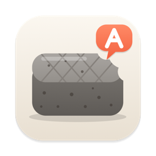

# konjac

Fast, private, on-device translation for macOS, powered by
[PLaMo 3 Translate](https://www.preferred.jp/ja/blog/tech/plamo-3-translate-weight-release)
from Preferred Networks. Everything runs locally; no text leaves your Mac.

> Status: early prototype. A command-line tool and a first version of the
> native menu-bar app are available.

## App

A menu-bar app that translates as you type. It embeds llama.cpp (prebuilt
XCFramework, pinned in `Package.swift`), so there is no Python or Homebrew
dependency at runtime.

### Install

Download `konjac-<version>.dmg` from the
[Releases](../../releases) page, open it, and drag konjac to Applications.
Apple silicon Macs only, macOS 14+.

konjac is not signed with an Apple Developer ID or notarized (that needs a paid
Apple Developer account), so macOS blocks the first launch. On macOS 15
(Sequoia) and later the old right-click → Open bypass is gone. Instead:

1. Open konjac once and dismiss the warning.
2. Go to System Settings → Privacy & Security, scroll down, and click
   **Open Anyway** next to konjac.

Or remove the quarantine flag from a terminal:

```bash
xattr -dr com.apple.quarantine /Applications/konjac.app
```

To verify the download, put the published `.sha256` file next to the DMG and run
`shasum -a 256 -c konjac-<version>.dmg.sha256`.

### Translate from any app

- Select text in any app, then right-click, Services, "Translate with konjac".
  The floating translator opens with the text translated. To add a shortcut,
  use System Settings, Keyboard, Keyboard Shortcuts, Services, Text,
  "Translate with konjac".
- Or select text and press ⌃⌥T. A small popup shows the translation next
  to the pointer. Press ⌃⌥T again to hide it.
- Reading the selection needs the Accessibility permission. konjac asks the
  first time; you can also allow it in Settings, which links to System
  Settings, Privacy & Security, Accessibility. konjac reads the selection
  through Accessibility, or in apps that don't support that (many browsers),
  sends ⌘C and puts your clipboard back afterwards. For that half second the
  selection is on the clipboard, so clipboard managers and Universal
  Clipboard may record it. Copied files from Finder or Mail come back as
  names only. Without the permission, copy text with
  ⌘C first and ⌃⌥T translates the clipboard.
- konjac is ad-hoc signed, so macOS treats each new version as a different
  app. After updating, remove konjac from the Accessibility list and allow
  it again; konjac asks once more after each update.
- In the popup, Return copies the translation and closes it, Esc or clicking
  elsewhere closes it, and ⌘E opens the full editor.
- The ⌃⌥T hotkey is fixed. If it does nothing, another app may already use
  that shortcut. Use the Services menu instead.

## Build from source

Requirements: macOS 14+ and Xcode with Swift 5.9 or later (CI uses Xcode 16.4).

```bash
./scripts/build-app.sh
open build/konjac.app
```

`./scripts/make-dmg.sh` builds `build/konjac-<version>.dmg` and its `.sha256`
(set `KONJAC_VERSION`, e.g. `1.2.3`; default `0.0.0`).

`swift test` runs the unit tests (prompt builder and target-language picker).

- The model is downloaded on first use to
  `~/Library/Application Support/konjac/`, from a pinned Hugging Face
  revision, and verified against a pinned SHA-256. Default is the 0.8B model
  (573 MB); Settings can switch to the 2B model (1.8 GB) for higher quality.
- RAM: about 0.8 GB for 0.8B and 2.1 GB for 2B while loaded. The model loads
  on the first translation and is unloaded after 5 minutes idle.
- With the model warm, a sentence translates in well under a second.

## CLI

Requirements: an Apple silicon Mac and [uv](https://docs.astral.sh/uv/).

```bash
./konjac.py "会議は来週の月曜日に変更されました。"
# The meeting has been rescheduled for next Monday.

echo "This system is convenient." | ./konjac.py -f plain
# このシステムは便利だ。

./konjac.py -t fr "Good morning, everyone."
# Bonjour à tous.
```

| Option | Meaning |
| --- | --- |
| `-t LANG` | Target language code (default: Japanese text → `en`, anything else → `ja`) |
| `-s LANG` | Source language code (default: auto-detect) |
| `-c TEXT` | Context to disambiguate the source text |
| `-g SRC=DST` | Glossary entry (repeatable) |
| `-f plain\|polite` | Japanese output style |
| `-m SIZE` | Model size: `0.8b`, `2b`, `8b` (default), `31b` |

The model is downloaded from Hugging Face on first run. The CLI reloads the
model on every call, so expect a few seconds per invocation.
Model revisions are pinned to specific Hugging Face commits (see `MODEL_REVISIONS` in `konjac.py`).

## Contributing and security

See [CONTRIBUTING.md](CONTRIBUTING.md) to build, test and send a pull request,
and [SECURITY.md](SECURITY.md) to report a vulnerability privately. Everyone
taking part agrees to the [code of conduct](CODE_OF_CONDUCT.md).

## License

konjac's own code is MIT-licensed (see [LICENSE](LICENSE)). The app bundles
llama.cpp (MIT); see [THIRD_PARTY_NOTICES.md](THIRD_PARTY_NOTICES.md).

Built with PLaMo. The PLaMo 3 Translate model weights are **not** part of
this repository: konjac downloads them from Preferred Networks, who license
them under the
[PLaMo Community License](https://plamo.preferredai.jp/info/plamo-community-license-en).
By using konjac you use the model and agree to that license. Read it in full;
in particular:

- Personal and academic use needs no registration. Any other use counts as
  commercial, including use at work or inside an organisation.
- Commercial use requires
  [registering with Preferred Networks](https://forms.gle/mTL8tBLrMYXKNZD56)
  first, and is allowed only if you (or your affiliated company) have annual
  revenue of 1 billion yen or less. Otherwise you need a separate commercial
  license from Preferred Networks.
- If you publish translations, say they were produced by PLaMo.
- You must be 18 or older, or have reached the age of legal capacity in your
  country, or have a guardian's consent.
